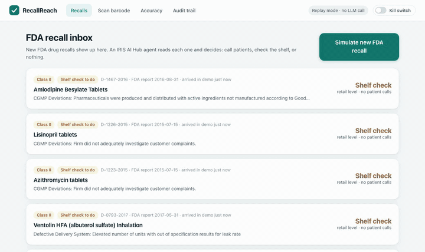
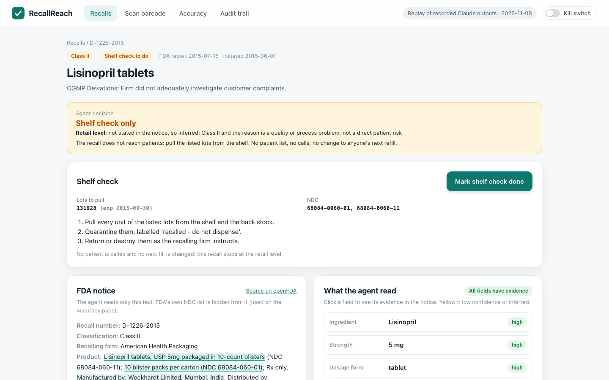
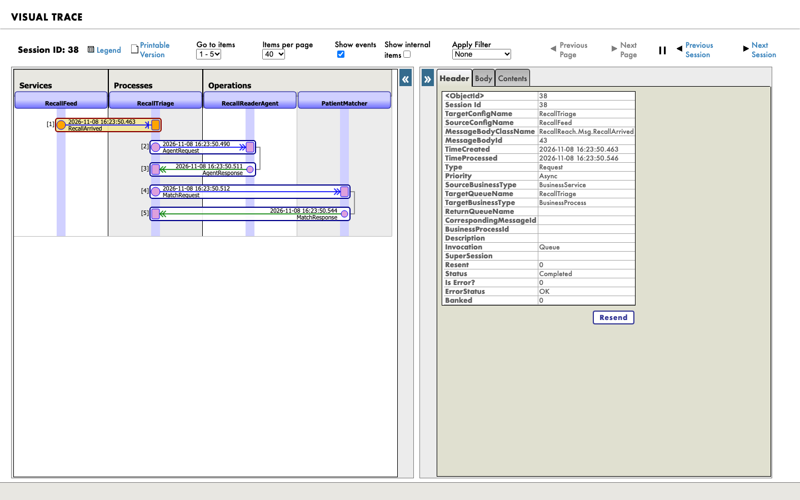
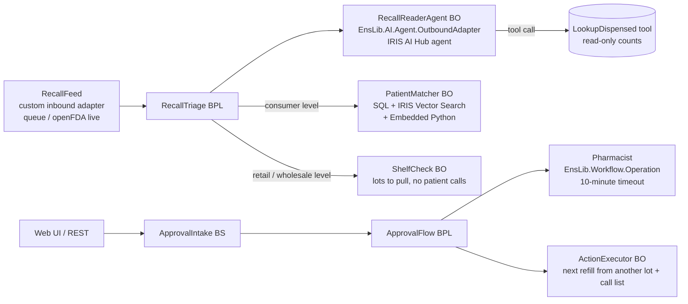

# RecallReach

When the FDA recalls a drug, RecallReach finds which pharmacy patients probably got it, and nothing happens until a pharmacist approves.



**For judges (2 minutes)**
1. Load the IRIS AI Hub image (see [Run it](#run-it)), then `docker compose up -d --build` and open http://localhost:52795/recallreach/index.html
2. Press *Simulate new FDA recall*, open it, press *Find patients*, then *Ask pharmacist approval* and *Approve*.
3. Real: MIMIC-IV demo patients, openFDA recalls, the IRIS production, tool calls, Workflow approval, audit, and 312 replies from `claude-haiku-5-5` recorded on 2026-11-08 (the 300 benchmark recalls and all 13 demo recalls). Replayed: with no API key (the default) the agent gets those recorded Claude replies back from a local endpoint, so no model is called and nothing is spent. With a key it calls Claude live ([Run with your own key](#run-with-your-own-key)).

## What it does

1. An IRIS AI Hub agent reads the FDA notice, works out how far the recall goes (consumer, retail or wholesale level), calls a read-only tool on the pharmacy records, and picks one of three ways: **contact patients**, **shelf check only**, or **nothing**.
2. Consumer level: patients are ranked in one list by estimated chance, with the formula and sources on every row. A lot scanned from the box at dispensing makes a row exact.
3. A pharmacist approves calls and "fill the next refill from a non-recalled lot" (the medicine is not stopped) through the IRIS Workflow Engine. The approval works once and expires in 10 minutes. A kill switch stops everything.
4. Retail or wholesale level: no patient list and no calls, just a shelf task with the lots to pull.
5. Every step is in the audit trail, in plain sentences, with a link to Visual Trace.

| The decision changes the flow | Visual Trace of one recall |
|---|---|
|  |  |

Data: 100 de-identified patients from MIMIC-IV Demo. Their records are **inpatient medication orders (MIMIC-IV demo) used as a stand-in for dispensing records** (18,087 orders), so "patient still has the medicine at home" is a story this data cannot prove; see [Limits](#limits). Plus 647 openFDA drug recalls and CMS Medicaid volumes.

## Run it

Built and tested on IRIS for Health Community 2027.1.0AI build 109 (`2027.1.0AI.109.0`, arm64 on Apple Silicon; organizers confirmed build 109 is accepted). The amd64 image of the same build should behave the same; not tested here.

The AI Hub image is on the InterSystems early-access portal, not on Docker Hub. Load it once:

```bash
# Apple Silicon / ARM64 file:
docker image load -i irishealth_arm64-community-2027.1.0AI.109.0-docker.tar.gz
# Intel / AMD64 file:
# docker image load -i irishealth-community-2027.1.0AI.109.0-docker.tar.gz
docker images | grep irishealth                     # see the name it loaded as, e.g.
# docker.iscinternal.com/docker-intersystems/intersystems/irishealth-community:2027.1.0AI.109.0
docker tag <that full name> intersystems/irishealth-community:2027.1.0AI.109.0
# (or set IRIS_IMAGE=<that full name> in .env instead of tagging)
```

Then:

```bash
git clone https://github.com/jejuolledev/recallreach && cd recallreach
docker compose up -d --build   # compiles, loads data, runs 7 recalls through the production (about 30 s to 3 min)
# then open http://localhost:52795/recallreach/index.html in a browser
```

No login for the app. Management Portal: http://localhost:52795/csp/sys/UtilHome.csp (`_SYSTEM` / `SYS`), production `RecallReach.Production` in namespace `USER`. Ports are bound to 127.0.0.1.

## Try it

1. **Scan** tab: *Use a sample barcode* -> *Read barcode* -> *Record lot here* on patient 10012853 (fill 7171). This plays the pharmacist who scanned the box when filling it. A barcode with a wrong check digit or no expiry is refused.
2. **Recalls** tab: the inbox already holds seven older recalls; five are shelf checks (retail level) and two are patient-contact recalls. *Simulate new FDA recall*: D-1206-2018 arrives and the agent reads it. It is a Class I recall of a daily blood-pressure tablet: bottles labeled Hydrochlorothiazide 12.5 mg could contain only Spironolactone 25 mg.
3. Open it. The decision box says **Patient contact**, consumer level (inferred: Class I). The notice is on the left, the extracted fields on the right; click a field to see its evidence.
4. *Find patients*: the list spins and stops on patient 10012853 (female, 91), now 100% with "Lot confirmed". Without the scan she is still first, at about 10%. Press *Why ...?* on any row for the formula and sources.
5. *Ask pharmacist approval* -> *Approve*. The button locks; *Try this link again* sends the same approval a second time and is refused (HTTP 409). An approval left for 10 minutes expires.
6. Open D-1226-2015 (lisinopril, "did not adequately investigate customer complaints"): **Shelf check only**. No patient list, no calls, a task with lot 131928 to pull, and *Mark shelf check done*.
7. Turn on the **Kill switch**: the agent, the feed, approvals and actions stop, and pending approvals are cancelled.
8. **Audit** and **Accuracy** tabs. Audit rows from an Interoperability session link to Visual Trace (portal login needed); kill switch, lot scans and demo resets have no session.

## How it works



| Production item | Class | What it does |
|---|---|---|
| RecallFeed | `RecallReach.Service.RecallFeed` + `RecallReach.Adapter.RecallFeedInboundAdapter` (custom) | Takes recalls from the demo queue, or polls `api.fda.gov` (`Source=openfda-live`). Stops while the kill switch is on. |
| RecallTriage | BPL | agent, then a `<switch>` on its decision: `no_action` closes; `stock_check` calls ShelfCheck; `hold_and_contact` calls PatientMatcher. Each way is a different path in Visual Trace. |
| ShelfCheck | `RecallReach.Operation.ShelfCheck` | Retail- or wholesale-level recall: writes one shelf task (lots and NDCs to pull and quarantine). No patient list, no calls, no change to anyone's refill. |
| RecallReaderAgent | `RecallReach.Operation.RecallReaderAgent` + `RecallReach.Adapter.AgentAdapter` (extends `EnsLib.AI.Agent.OutboundAdapter`) | Runs `RecallReach.AI.RecallReaderAgent` (`%AI.Agent`, provider `anthropic`, model `claude-haiku-5-5`). The agent extracts ingredient, strength, form, labeler, NDCs, lots, expiry and distribution with verbatim evidence, works out the recall depth, calls the `LookupDispensed` tool, and decides `hold_and_contact` / `stock_check` / `no_action`. |
| PatientMatcher | `RecallReach.Operation.PatientMatcher` | Exact NDC (SQL index), same product code, and ingredient match through IRIS Vector Search (`VECTOR_COSINE` on drug-name vectors). Probability in Embedded Python. |
| ApprovalIntake, ApprovalFlow | BS + BPL | Workflow task to role `Pharmacist`, `<sync timeout=615>`; on approve calls ActionExecutor, on timeout marks the approval expired. |
| Pharmacist | `EnsLib.Workflow.Operation` | IRIS Workflow Engine (AutoCreateRole). |
| ActionExecutor | `RecallReach.Operation.ActionExecutor` | Re-checks the kill switch and the approval state, flags each approved patient's next refill to be filled from a non-recalled lot (the medicine is not stopped), writes the call list. |
| BenchmarkRunner | BS | Sends benchmark recalls to the agent for live accuracy runs. |

### The agent's decision

- **Inputs**: only the free text of the FDA notice. FDA's harmonized `openfda` block (its NDC list) is hidden from the agent and used only to grade it.
- **Tool**: `RecallReach.AI.PharmacyTools.LookupDispensed(ndcs, ingredient)`, a `%AI.Tool` registered on the agent's `ToolManager`. Returns counts only, no patient ids.
- **Policies** (adapter settings): `RecallReach.AI.KillSwitchPolicy` (`%AI.Policy.Authorization`: no tool runs while the kill switch is on) and `RecallReach.AI.ToolAudit` (`%AI.Policy.Audit`: every tool call goes to the audit trail).
- **Recall depth decides the branch.** Patients are called only for a consumer-level recall. openFDA enforcement records have no depth field, and only 2 of the 647 shipped notices say it in the text ("retail level"). So: if the notice states the level, that wins (quoted as evidence). Otherwise the rule is: Class I = consumer; Class II = consumer only if the reason names a direct patient risk (non-sterile, contamination, particulate or foreign matter, wrong drug or label, super- or sub-potent); other Class II and Class III = retail. The UI shows "(inferred)" and the reason. If the agent says `hold_and_contact` for a recall that is not consumer level, the validator turns it into `stock_check`.
- **Guard rails**: every value must quote verbatim evidence from the notice; values whose evidence is not in the notice are marked low confidence and are not used for matching. A non-JSON reply is an error, not a silent pass. The plan a pharmacist approves can only contain patients from the ranked list.

### LLM calls traced as Interoperability messages (Ideas Portal DPI-I-689)

Every LLM call is an `AgentRequest` / `AgentResponse` message pair: prompt, raw reply, provider, model, tokens, cost, latency, decision, low-confidence count. Open any session in Visual Trace, or the LLM table on the Accuracy page.

### Replay mode (no key)

With no `ANTHROPIC_API_KEY`, the adapter creates the same AI Hub `anthropic` provider with `base_url` pointing to `/recallreach/replay/v1/` on this IRIS instance (local requests only). That endpoint speaks the Anthropic Messages API: it first asks for the `LookupDispensed` tool like the live model does, then answers with the recorded live reply for that recall from `data/recordings/` (312 ship: `claude-haiku-5-5`, 2026-11-08), or with a deterministic rule-based reference reply for a recall that has no recording. So `%AI.Agent.Chat`, tool execution, policies and sessions all run for real; the tool call is run again against the pharmacy records, and the token counts in replay are estimates, not model usage. The header says "Replay of recorded Claude outputs · 2026-11-08", and each recall says whether its answer is a recorded Claude reply or rule-based.

### The probability (an estimate, shown with its sources)

```
P(fill)    = product match x time on shelf x lot share x region
P(patient) = average over MIMIC's date shift of [ 1 - product(1 - P(fill)) ]
             (MIMIC shifts all dates of a patient by ONE unknown offset, so the fills move together)
```

| Factor | Value | Source |
|---|---|---|
| Product match | 1.0 same NDC; 0.9 same product code, other package; 0.25 no NDC on record but same ingredient+strength; 0.02 same ingredient+strength but a different NDC (only if the record is wrong); 0.005 other strength | FDA notice vs dispensing record |
| Time on shelf | share of the patient's possible real fill dates that falls in the lot window (expiry minus 24-month shelf life, until the recall started) | MIMIC `anchor_year_group` (MIMIC shifts dates; the real date is only known within ~3 years) + FDA lot/expiry |
| Lot share | recalled quantity / Medicaid units for that NDC in the window, capped at 100% (solid oral forms only; Medicaid counts mL/g for others, so a 50% heuristic is used and labelled) | openFDA `product_quantity` + CMS Medicaid State Drug Utilization Data (cached in `data/sdud_cache.json`) |
| Region | 1.0 nationwide or includes MA; 0.05 outside; 0.7 not stated | FDA `distribution_pattern` (MIMIC is from Boston) |
| **Barcode lot** | if the GS1 DataMatrix was scanned at dispensing: exactly 1 (lot on the recall) or 0 | `(01)` GTIN, `(17)` expiry, `(10)` lot, `(21)` serial |

- Only a scanned lot gives 100% ("exact"). An estimate is capped at 99% and shown rounded (5% steps above 10%, e.g. "≈55%"); the exact factors are in each row's "Why" panel.
- A scan is saved only if the GTIN check digit is right and the barcode has a lot and an expiry; otherwise nothing is stored.
- Lot share does little in practice: in 12 of the 13 demo recalls it is either capped at 1.0 (the recall is larger than the Medicaid volume) or the 50% default for liquids and injections; only D-0648-2016 gets a real ratio (0.76). So the ranking mostly comes from product match and time on shelf. The "Why" panel says which case applies.
- Rows under 5% are hidden below the list. Medicaid covers only part of US dispensing, so the lot share over-states the true share; each row's "Why" panel says so.

## Numbers you can check

- Demo recall **D-1206-2018** (Class I, Hydrochlorothiazide Tablets USP 12.5 mg, Accord Healthcare, NDC 16729-182-01, lot PW05264 exp 11/2019, 46,632 bottles, nationwide; reason: the bottle held Spironolactone 25 mg). 6 MIMIC patients have a hydrochlorothiazide order; 2 of them got the recalled NDC. 1 shown, 5 under 5%. With lot PW05264 scanned for patient 10012853: 100%, "Lot confirmed". Without a scan she is first at about 10% (0.12 before rounding).
- D-0464-2017 (Class II, oxycodone oral solution, water possibly contaminated with *Burkholderia cepacia*): consumer level (inferred), 14 shown, 50 under 5%.
- D-1226-2015 (Lisinopril 5 mg, Class II, complaint-handling problem): retail level (inferred), shelf check for lot 131928. The tool still reports 11 orders of the recalled NDC for 7 patients; nobody is called.
- Depth in the 647 shipped recalls: stated in the text for 2; inferred for the rest.
- 372 of 18,076 openFDA drug recalls share an NDC with the 100 MIMIC demo patients.
- **Accuracy** (Accuracy tab, 300 random recalls that carry FDA's NDC list, fixed seed; the extractor never sees that list):

  | | Claude agent (`claude-haiku-5-5`, live run 2026-11-08) | Rule-based reference |
  |---|---|---|
  | Found an FDA product NDC | **99.3%** | 99.7% |
  | Found an exact FDA package NDC | **99.3%** | 99.7% |
  | Ingredient matches FDA's generic name | **98.0%** | 81.7% |
  | Extracted an NDC that FDA does not list | **0 of 300** | 0 of 300 |

  Claude's 0.4-point NDC gap is its 2 replies out of 300 that were not valid JSON (D-0354-2025, D-0842-2022); they are counted as misses, not retried. Its ingredient misses are listed on the page (e.g. it read "Insulin aspart" where FDA's generic name field says "WATER INJECTION"). The rule-based extractor's weak spot is brand names like "Kids' Cough and Chest Congestion".
- **Cost of the live run:** 312 agent calls (the 300 benchmark recalls plus the 12 demo recalls that are not in the benchmark; the demo has 13 recalls and D-0010-2016 is in both), 739,862 input and 417,387 output tokens as reported by the API, **$0.28** at the list price of $0.10 / $0.50 per million tokens. About 6 s and $0.0009 per recall (two model turns with one tool call). The agent's decision matched the rule-based decision on all 13 demo recalls.

## Run with your own key

```bash
cp .env.example .env          # put your Anthropic key after ANTHROPIC_API_KEY= (never commit .env)
./tools/run_benchmark.sh      # or ./tools/run_benchmark.sh 20 for a short run
```

The script restarts the container with the key (container environment only; the app never logs it, stores it or sends it to the browser, and the script does not print it), waits until the header says "Live AI Hub agent", sends the benchmark recalls and the demo recalls to the agent (recalls that already have a recording are skipped; delete `data/recordings/*.json` first for a fresh run), copies every reply to `data/recordings/`, and refreshes the Accuracy page, which shows Claude next to the rule-based numbers, misses included. Recalls you simulate in live mode are recorded too. Spend stops at `RR_SPEND_CAP_USD` (default $5); our run with `claude-haiku-5-5` cost about $0.0009 per recall, $0.28 for 312 calls. Commit `data/recordings/` to replay those replies without a key. Before live mode on a shared machine, change the `_SYSTEM` password: anyone with Management Portal access can read the container environment.

## Tests

```bash
./tools/run_tests.sh
```

- 36 Python unit tests (`python/tests/test_core.py`, run with IRIS's `irispython`): NDC layouts, GS1 parsing, extraction on a real recall, recall depth (stated, inferred, guard rail, agent quote must be in the notice), decision per depth, singular/plural, hallucinated evidence, JSON reply parsing, MIMIC date windows, lot window, lot share, exact only from a scanned lot, estimate cap, ranking, vectors, accuracy scoring.
- ObjectScript `%UnitTest` `RecallReach.Tests.ApprovalTest` (14 test methods): token stored only as SHA-256, 10-minute expiry, single use, kill switch, reject needs a reason, plan only from the ranked list, a shelf-check recall takes no patient plan, duplicate patients count once, audit rows cannot be edited, replay + validation bridge (including the depth rule), GS1 bridge, time arithmetic.
- `tools/screens.mjs`: headless Playwright walk-through (screenshots in `_screens/`), a 10-spin check at 1440 px and 390 px that the reel stops on the #1 patient, and the video for `docs/spin.gif`.

## Bonus checklist

| Bonus | Where |
|---|---|
| Embedded Python | `python/recallreach_core` (extraction, GS1, probability, vectors) called from `RecallReach.Core.Py` |
| Workflow Engine | `Pharmacist` = `EnsLib.Workflow.Operation`, `ApprovalFlow` BPL |
| Agent decision drives the flow | `RecallTriage` BPL `<switch>`: patient matching vs. `ShelfCheck` vs. close |
| Custom adapter | `RecallReach.Adapter.RecallFeedInboundAdapter` (inbound), `RecallReach.Adapter.AgentAdapter` (outbound, extends the AI Hub adapter) |
| Vector Search | `RecallReach.Data.DrugName.Vec` (`%Vector`, 128-d), `VECTOR_COSINE` in `RecallReach.Core.Py.Match` |
| Docker | `Dockerfile`, `docker-compose.yml` |
| IPM | `module.xml` |
| Community idea DPI-I-689 | LLM calls as Interoperability messages (`RecallReach.Msg.AgentRequest/AgentResponse`) |

## Data and privacy

- Patients: MIMIC-IV Clinical Database Demo v2.2 (PhysioNet, ODbL v1.0), 100 real de-identified patients. No names; dates are shifted by MIMIC; ages over 89 are capped by MIMIC. Derived data in `data/` stays under ODbL (see LICENSE).
- Recalls: openFDA drug enforcement (public domain). Volumes: CMS Medicaid State Drug Utilization Data.
- The demo has no login and holds no real pharmacy data. Do not put real patient data in it. The web apps run unauthenticated with full rights so the demo works without an account; in the demo the person who asks for approval also holds the approval link. A real deployment would put the approve route behind a pharmacist login.
- Not for clinical use. Probabilities are estimates.

## Limits

- MIMIC is a hospital. Its records are inpatient medication orders, used here as a stand-in for a pharmacy's dispensing records. Many demo products (IV bags, unit-dose cups) are given on the ward, not taken home. MIMIC has no lot numbers; the lot path is shown by scanning a sample barcode generated by the app (not a real package serial).
- Recall depth is rarely in the openFDA text, so it is usually inferred by the rule above. A real FDA recall letter can say otherwise; the UI marks every inferred depth.
- No inventory data: the shelf check lists what to pull but cannot say how many units are on hand.
- MIMIC dates are shifted, so "when" is only known within a ~3-year window; this is why the time factor exists.
- The live run was one pass of one model (`claude-haiku-5-5`) on 2026-11-08. A different model or a later run can give different numbers.
- `module.xml` is written for IPM but was not installed with IPM in this environment (IPM is not in the AI Hub image); Docker is the tested path.

## Files

- `src/RecallReach/` ObjectScript: `AI/` agent, tool, policies; `Adapter/`; `Service/`; `Process/` BPLs; `Operation/`; `API/` REST + replay; `Core/` setup, approvals, config; `Data/` tables; `Tests/`
- `python/recallreach_core/` Embedded Python core, `python/tests/`
- `web/` UI (plain HTML/CSS/JS, served by IRIS)
- `data/` shipped data, `tools/` data prep, SDUD fetch, tests, screenshots, live benchmark, `docs/` README GIF

License: MIT (code). Data: see LICENSE.
