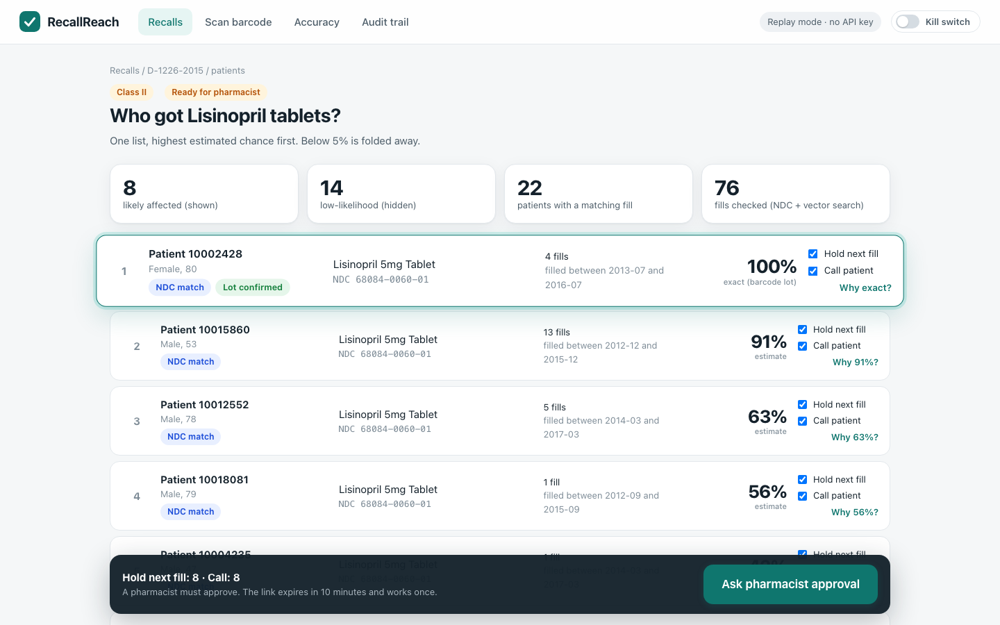
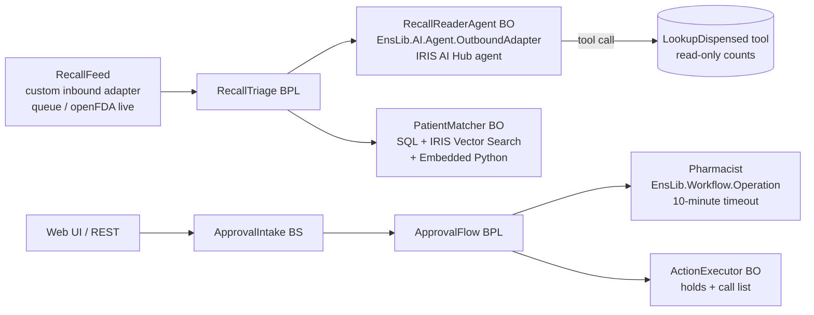

# RecallReach

**An FDA drug recall arrives. An IRIS AI Hub agent reads it, checks the pharmacy's records with a tool, and decides what to do. RecallReach then ranks the patients who may have the recalled pills in one list, by estimated probability. A pharmacist approves holds and phone calls through the IRIS Workflow Engine. The approval expires in 10 minutes and works once. A kill switch stops everything, and every step is in the audit trail and in Visual Trace.**



- Real data: 100 real de-identified patients and 18,087 dispensing records from MIMIC-IV Demo, 647 real openFDA recalls, CMS Medicaid volumes.
- Runs with **no API key** (replay mode) on the first `docker compose up`. Set one env var for the live Anthropic model.
- Built on **IRIS for Health Community 2027.1.0AI build 109** (`2027.1.0AI.109.0`, arm64). Build 154 was taken off the portal; organizers said 109 is fine if the README says so.

## Quick start (3 commands)

The AI Hub image is on the InterSystems early-access portal, not on Docker Hub. Load it once:

```bash
docker image load -i irishealth_arm64-community-2027.1.0AI.109.0-docker.tar.gz   # or the amd64 file
docker images | grep irishealth-community                                          # see the name it got
docker tag <that name>:2027.1.0AI.109.0 intersystems/irishealth-community:2027.1.0AI.109.0
```

Then:

```bash
git clone <this repo> && cd recallreach
docker compose up -d --build        # ~3 min the first time: compiles, loads data, runs 6 recalls through the production
open http://localhost:52795/recallreach/
```

No login for the app. Management Portal: http://localhost:52795/csp/sys/UtilHome.csp (`_SYSTEM` / `SYS`), production `RecallReach.Production` in namespace `USER`.

Live LLM (optional): `cp .env.example .env`, put your key in `ANTHROPIC_API_KEY`, `docker compose up -d`. The header then shows "Live AI Hub agent · claude-haiku-5-5". Spend is capped by `RR_SPEND_CAP_USD` (default $5). The key is read from the container environment only; it is never logged, stored or sent to the browser.

## Try it (2 minutes)

1. **Scan barcode** tab: *Use a sample barcode* -> *Read barcode* -> *Record lot here* on patient 10002428. (This plays the pharmacist who scanned the box when filling it.)
2. **Recalls** tab: *Simulate new FDA recall*. A real FDA recall (D-1226-2015, Lisinopril 5 mg) arrives; the AI Hub agent reads it.
3. Open it: the notice is on the left, the fields the agent extracted on the right. Click a field to see its evidence. Low-confidence fields are yellow.
4. *Find patients*: the list spins and stops on the top patient. Press *Why 91%?* on any row for the formula and sources.
5. *Ask pharmacist approval* -> *Approve*. Press it again: refused, the link is single use. Wait 10 minutes: expired.
6. Turn on the **Kill switch**: the agent, the feed, approvals and actions all stop.
7. **Audit trail** and **Accuracy** tabs. Each audit row links to Visual Trace.

## How it works



| Production item | Class | What it does |
|---|---|---|
| RecallFeed | `RecallReach.Service.RecallFeed` + `RecallReach.Adapter.RecallFeedInboundAdapter` (custom) | Takes recalls from the demo queue, or polls `api.fda.gov` (`Source=openfda-live`). Stops while the kill switch is on. |
| RecallTriage | BPL | agent -> (if action is not `no_action`) matcher -> status |
| RecallReaderAgent | `RecallReach.Operation.RecallReaderAgent` + `RecallReach.Adapter.AgentAdapter` (extends `EnsLib.AI.Agent.OutboundAdapter`) | Runs `RecallReach.AI.RecallReaderAgent` (`%AI.Agent`, provider `anthropic`, model `claude-haiku-5-5`). The agent extracts ingredient, strength, form, labeler, NDCs, lots, expiry and distribution with verbatim evidence, calls the `LookupDispensed` tool, and decides `hold_and_contact` / `stock_check` / `no_action`. |
| PatientMatcher | `RecallReach.Operation.PatientMatcher` | Exact NDC (SQL index), same product code, and ingredient match through IRIS Vector Search (`VECTOR_COSINE` on drug-name vectors). Probability in Embedded Python. |
| ApprovalIntake, ApprovalFlow | BS + BPL | Workflow task to role `Pharmacist`, `<sync timeout=615>`; on approve calls ActionExecutor, on timeout marks the approval expired. |
| Pharmacist | `EnsLib.Workflow.Operation` | IRIS Workflow Engine (AutoCreateRole). |
| ActionExecutor | `RecallReach.Operation.ActionExecutor` | Re-checks the kill switch and the approval state, flags next fills on hold, writes the call list. |
| BenchmarkRunner | BS | Sends benchmark recalls to the agent for live accuracy runs. |

### The agent's decision

- **Inputs**: only the free text of the FDA notice. FDA's harmonized `openfda` block (its NDC list) is hidden from the agent and used only to grade it.
- **Tool**: `RecallReach.AI.PharmacyTools.LookupDispensed(ndcs, ingredient)`, a `%AI.Tool` registered on the agent's `ToolManager`. Returns counts only, no patient ids.
- **Policies** (adapter settings): `RecallReach.AI.KillSwitchPolicy` (`%AI.Policy.Authorization`: no tool runs while the kill switch is on) and `RecallReach.AI.ToolAudit` (`%AI.Policy.Audit`: every tool call goes to the audit trail).
- **Guard rails**: every value must quote verbatim evidence from the notice; values whose evidence is not in the notice are marked low confidence and are not used for matching. A non-JSON reply is an error, not a silent pass. The plan a pharmacist approves can only contain patients from the ranked list.

### LLM calls traced as Interoperability messages (Ideas Portal DPI-I-689)

Every LLM call is an `AgentRequest` / `AgentResponse` message pair: prompt, raw reply, provider, model, tokens, cost, latency, decision, low-confidence count. Open any session in Visual Trace, or the LLM table on the Accuracy page.

### Replay mode (no key)

With no `ANTHROPIC_API_KEY`, the adapter creates the same AI Hub `anthropic` provider with `base_url` pointing to `/recallreach/replay/v1/` on this IRIS instance (local requests only). That endpoint speaks the Anthropic Messages API: it first asks for the `LookupDispensed` tool like the live model does, then answers with a recorded live reply for that recall if one exists in `data/recordings/`, or else with a deterministic rule-based reference reply. So `%AI.Agent.Chat`, tool execution, policies, sessions and token stats all run for real. The UI labels which source produced each answer.

### The probability (an estimate, shown with its sources)

```
P(fill)    = product match x time on shelf x lot share x region
P(patient) = 1 - product(1 - P(fill))  over that patient's fills
```

| Factor | Value | Source |
|---|---|---|
| Product match | 1.0 same NDC; 0.9 same product code, other package; 0.25 no NDC on record but same ingredient+strength; 0.02 same ingredient+strength but a different NDC (only if the record is wrong); 0.005 other strength | FDA notice vs dispensing record |
| Time on shelf | share of the patient's possible real fill dates that falls in the lot window (expiry minus 24-month shelf life, until the recall started) | MIMIC `anchor_year_group` (MIMIC shifts dates; the real date is only known within ~3 years) + FDA lot/expiry |
| Lot share | recalled quantity / Medicaid units for that NDC in the window, capped at 100% (solid oral forms only; Medicaid counts mL/g for others, so a 50% heuristic is used and labelled) | openFDA `product_quantity` + CMS Medicaid State Drug Utilization Data (cached in `data/sdud_cache.json`) |
| Region | 1.0 nationwide or includes MA; 0.05 outside; 0.7 not stated | FDA `distribution_pattern` (MIMIC is from Boston) |
| **Barcode lot** | if the GS1 DataMatrix was scanned at dispensing: exactly 1 (lot on the recall) or 0 | `(01)` GTIN, `(17)` expiry, `(10)` lot, `(21)` serial |

Rows under 5% are folded into "n low-likelihood hidden". Medicaid covers only part of US dispensing, so the lot share over-states the true share; the UI says so on every row.

## Numbers you can check

- Demo recall **D-1226-2015** (Class II, Lisinopril 5 mg unit-dose tablets, American Health Packaging / Wockhardt, lot 131928 exp 2015-09-30, 4,718 cartons, nationwide). 22 MIMIC patients had a lisinopril fill; 8 shown, 14 hidden; 7 got the exact recalled NDC 68084-0060-01. Top without a barcode: patient 10015860, 91%. With the lot scanned for patient 10002428: 100%, "Lot confirmed".
- 372 of 18,076 openFDA drug recalls share an NDC with the 100 MIMIC demo patients.
- **Accuracy** (Accuracy tab, 300 random recalls that carry FDA's NDC list, fixed seed): the rule-based reference finds an FDA product NDC in **99.7%**, an exact package NDC in **99.7%**, extracts no NDC that FDA does not list in **300/300**, and its ingredient matches FDA's generic name in **78.7%** (brand names like "Kids' Cough and Chest Congestion" are its weak spot). Live LLM accuracy is not in this build because no key was available at build time: run `tools/run_benchmark.sh` with a key (about $0.0004 per recall with claude-haiku-5-5) and the page shows it next to the rule-based numbers, wrong cases included.

## Tests

```bash
./tools/run_tests.sh
```

- 27 Python unit tests (`python/tests/test_core.py`, run with IRIS's `irispython`): NDC layouts, GS1 parsing (human-readable, raw with group separator, `]d2` prefix, day 00), extraction on a real recall, hallucinated evidence, JSON reply parsing, MIMIC date windows, lot window, lot share cap and heuristic, exact lot confirmed/cleared, ranking and hidden tail, vectors, accuracy scoring.
- ObjectScript `%UnitTest` `RecallReach.Tests.ApprovalTest`: token stored only as SHA-256, 10-minute expiry, single use (approve twice, reject after approve), kill switch cancels pending approvals and refuses new ones, reject needs a reason, plan only from the ranked list, audit rows cannot be edited, replay + validation bridge, GS1 bridge, time arithmetic.
- `tools/screens.mjs`: headless Playwright walk-through of the whole demo (screenshots in `_screens/`).

## Bonus checklist

| Bonus | Where |
|---|---|
| Embedded Python | `python/recallreach_core` (extraction, GS1, probability, vectors) called from `RecallReach.Core.Py` |
| Workflow Engine | `Pharmacist` = `EnsLib.Workflow.Operation`, `ApprovalFlow` BPL |
| Custom adapter | `RecallReach.Adapter.RecallFeedInboundAdapter` (inbound), `RecallReach.Adapter.AgentAdapter` (outbound, extends the AI Hub adapter) |
| Vector Search | `RecallReach.Data.DrugName.Vec` (`%Vector`, 128-d), `VECTOR_COSINE` in `RecallReach.Core.Py.Match` |
| Docker | `Dockerfile`, `docker-compose.yml` |
| IPM | `module.xml` |
| Community idea DPI-I-689 | LLM calls as Interoperability messages (`RecallReach.Msg.AgentRequest/AgentResponse`) |

## Data and privacy

- Patients: MIMIC-IV Clinical Database Demo v2.2 (PhysioNet, ODbL v1.0), 100 real de-identified patients. No names; dates are shifted by MIMIC; ages over 89 are capped by MIMIC. Derived data in `data/` stays under ODbL (see LICENSE).
- Recalls: openFDA drug enforcement (public domain). Volumes: CMS Medicaid State Drug Utilization Data.
- The demo has no login and holds no real pharmacy data. Do not put real patient data in it.
- Not for clinical use. Probabilities are estimates.

## Limits, honestly

- MIMIC is a hospital, not a retail pharmacy, and has no lot numbers; the lot path is shown by scanning a sample barcode (generated by the app, not a real package serial).
- MIMIC dates are shifted, so "when" is only known within a ~3-year window; this is why the time factor exists.
- Live LLM accuracy was not measured in this build (no key at build time).
- `module.xml` is written for IPM but was not installed with IPM in this environment (IPM is not in the AI Hub image); Docker is the tested path.

## Files

- `src/RecallReach/` ObjectScript: `AI/` agent, tool, policies; `Adapter/`; `Service/`; `Process/` BPLs; `Operation/`; `API/` REST + replay; `Core/` setup, approvals, config; `Data/` tables; `Tests/`
- `python/recallreach_core/` Embedded Python core, `python/tests/`
- `web/` UI (plain HTML/CSS/JS, served by IRIS)
- `data/` shipped data, `tools/` data prep, SDUD fetch, tests, screenshots, live benchmark

License: MIT (code). Data: see LICENSE.
